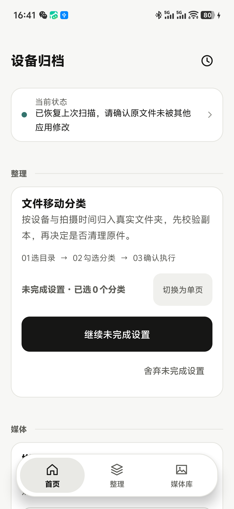
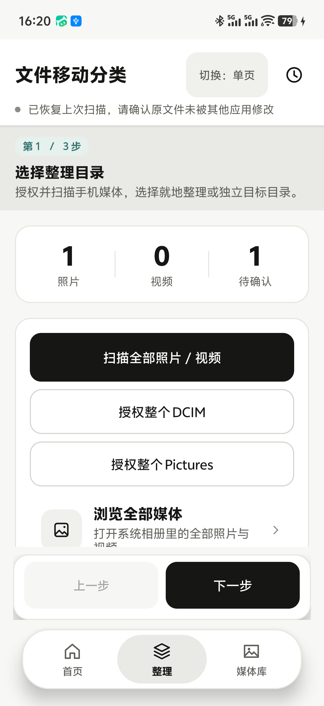
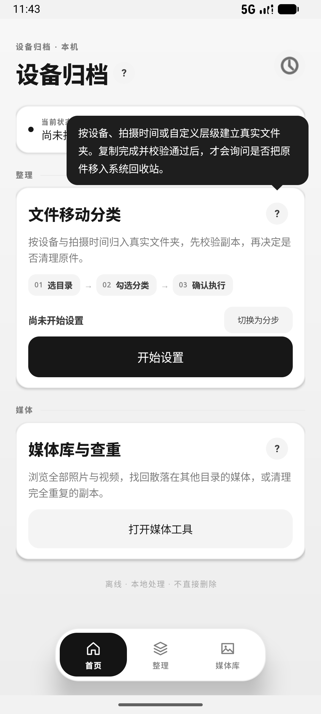

# 归藏 · Trove

> 把手机里的照片，送回它该在的地方。

「归藏」是古三易之一，取「万物莫不归而藏于其中」——和这个 App 做的事一样：**收回、归位、藏好**。

一个离线 Android 照片 / 视频整理 App。文件留在手机里，按媒体元数据中的拍摄设备、拍摄日期建立真实文件夹；也可以把一批文件平铺复制到指定目录，核对无误后再通过系统回收站移走原件。

- 仓库：<https://github.com/sAchNMN/trove>
- 当前构建：**0.7.0**（`versionCode 9`），面向 Android 9+，不需要 root
- 自行打包：`./gradlew assembleDebug`（JDK 17/21 + Android SDK Platform 34），产物在 `app/build/outputs/apk/debug/`。仓库只放源码与文档，不含 APK 等构建产物
- 这是本地调试签名的测试版本，尚未上架 Google Play，也未经过独立安全审计

## 界面预览

| 首页 | 整理 | 按位置出现的提示 |
| --- | --- | --- |
|  |  |  |

## 0.7.0 的界面与底部导航

- **整理过的文件默认不再「凭空消失」**：扫描默认跳过 `分类` 文件夹里的文件，结果行会写明「已归档跳过 N 个」。扫描卡新增开关「包含已归档的文件」（默认关），打开后重新扫描就能看到并重新整理这些文件；重新整理时目标路径截断在第一个 `分类`，不会生成 `分类/分类`。只认「分类」这一层，`Android/data`、`.thumbnails`、`cache` 等私有目录仍然永远不读。

- **底部导航只跟着手指走**：向下滑动时收起（180 ms 下滑淡出），停手后**不会**自己回来；只有向上滑动或回滚到页面顶部时才重新出现（220 ms 淡入）。原来的「停 0.5 秒自动浮现」已删除——导航条自己弹出来，正好会挡住下一次点击。
- **一屏一个标题**：去掉页面标题上方 11sp 的小字（`整理 · 本地文件`、`设备归档 · 本机`、`媒体`），三个页面统一 20sp；卡片标题统一 16sp，不再和页面标题同字号。
- **文字撑开容器**：所有可能换行的按钮改成 `wrap_content` + 最小高度。`授权整个 DCIM / 授权整个 Pictures` 改为竖排；`打开全部照片 / 视频（含 Download）` 改成列表行「浏览全部媒体」；`重建媒体索引（重新读取拍摄信息）` 不再被 48dp 卡掉半行。
- **分类策略不再是空输入框**：整宽浅灰按钮改成一行「分类策略 · 设备 / 拍摄年月 ›」，整行可点。
- **说明按需保留**：单页模式从 7 个 `?` 减到 1 个（只保留「就地分类 / 目标目录」这个真正容易混淆的概念），其余说明改成 12–13sp 的一行文字或直接删除。
- **删掉写在界面上的需求**：`单页模式 · 从上到下完成设置`、`这里只扫描上面补充授权的目录` 等实现说明全部移除；按钮改为「扫描这些目录」。
- **空状态有出口**：没有扫描结果时显示「还没有可以整理的媒体」+ 一句原因 + 「扫描全部照片 / 视频」按钮；统计卡片在 0 条结果时隐藏，不再显示 0/0/0。
- **给 0 个文件一个说法**：扫描结束时区分「授权已失效」「目录里没有照片或视频」「部分目录为空」，不再用一句「扫描完成 · 0 个媒体文件」糊过去；来源目录行显示 `已授权` 或 `授权已失效 · 点按重新授权`，点一下就能重新授权同一个目录，不会被判成"重复来源"。
- **导航更轻**：导航条 64dp 高，选中态从整块黑色药丸改成浅灰底 + 黑字，内容底部留白按导航高度重算，滚到最底时最后一张卡不再被盖住。
- **分步操作条不再压住内容**：底部「上一步 / 下一步」原来是浮在内容上的一层，正好挡住来源列表和「扫描这些目录」。现在它参与页面布局，内容在它上方滚动，留白只够避让导航条。
- **按钮文字不再被裁**：`下一步：分类预览`、`下一步：执行与开始` 在半宽按钮里会折行并被 50dp 固定高度切掉。按钮文案改成 `上一步 / 下一步`（下一步做什么由步骤标题说明），高度改由内容撑开 + 最小高度。
- **状态行最多两行**：标题下的状态原来会把区间说明、缓存统计全塞进一行，347dp 宽屏幕上换不了行、直接被切。现在保留「待整理 / 已归档跳过 / 用时」这些用户要看的数字，完整范围在扫描卡上另有一行，点状态仍可看全文。

## 0.6.0 的界面重做

- **三层视觉层次**：页面用浅灰底，内容放在白色悬浮卡片里，主要操作是黑色实心按钮，次要操作是浅灰按钮。层级只靠圆角、细边框、阴影和字重区分，不再用绿色/青色强调；禁用态整体降低对比度。媒体库和查重弹窗也换成了同一套黑白灰。
- **底部悬浮导航**：`首页 / 整理 / 媒体库` 固定在拇指容易够到的底部。向下滚动时导航收起，停止滚动 0.5 秒后重新淡入；再次点当前标签会回到该页顶部。分步模式的“上一步 / 下一步”浮在导航上方，两层不会互相遮挡。
- **说明按需出现**：卡片标题、目标位置、目录列表等旁边的 `?` 默认不显示大段文字。点按后才弹出气泡；气泡优先出现在按钮上方，上方空间不足时翻到下方并留出 10dp 间距，气泡尖角指向对应控件，手指不会盖住提示。滚动、切换页面或 4.6 秒后自动消失。
- **压缩页面信息**：去掉首页“更多功能”占位卡、常驻说明段落，以及 0.4.0 的顶部/底部跳转条；状态收进标题下方的一行，低频说明收进 `?`。媒体库、查重弹窗里的长解释也缩短为一句。
- **保留安全提示**：授权范围不完整时仍然显示加粗黑色的 `!` 提示，因为这不是装饰性说明；危险操作仍由系统回收站弹窗二次确认，不靠颜色区分。

## 0.5.0 解决的反复全量扫描问题

- **不再每次任务后重新读取全部文件**：复制、移动、移入回收站、查重之后，App 仍会向 MediaStore 确认“现在有哪些文件”，但只为**新增或发生变化**的文件读取 EXIF / QuickTime。未变化的文件直接复用上次解析结果。媒体库大时，这一步从“逐个打开并解析所有照片和视频”变成“一次轻量索引查询 + 少量文件读取”。
- **持久化元数据缓存**：解析结果保存在 App 私有目录的 `media-cache.json`，键是 MediaStore URI，并记录读取时的文件大小和修改时间。App 重启后仍然有效，不再因为一次启动或一次任务就从零开始。
- **只凭变化判断，不凭猜测**：缓存失效条件是 MediaStore 里的大小、修改时间、类型、分辨率或时长发生变化。文件被移动（路径变化）时保留原元数据，只更新位置，不会因为“换了文件夹”就重新读一遍。
- **新照片会及时出现**：App 在前台时会监听 MediaStore 的变更通知，并在回到前台时比较存储卷的 generation 计数器。只有确实有变化才发起增量同步；没有变化时连查询都跳过。刚拍的照片、微信刚保存的图片，回到 App 后会出现在媒体库中。
- **打开媒体库不再先扫描**：如果索引仍然是最新的，点“浏览全部照片 / 视频”会立即打开；只有索引落后时才先做一次增量同步。分类页的已勾选目录也不会因为重新同步而被清空。
- **一次性的重建入口**：长按“扫描全部照片 / 视频”，或在“媒体库与查重”页点“重建媒体索引（重新读取拍摄信息）”，可以强制重新读取全部元数据。平时不需要；只有怀疑设备名、日期读错，或拍照 App 在原文件上改写了 EXIF 但大小和修改时间没变时才使用。
- **缓存不会替代校验**：复制或移动前仍会重新读取源文件的大小、修改时间和内容哈希。缓存只决定“是否需要重新解析元数据”，不会让 App 在文件已变化时继续使用旧判断。
- **本地模拟器实测**：43 个已索引媒体首次建立缓存用 0.5 秒；第二次无变化同步显示“复用缓存 43 · 0.1 秒”；从外部插入 1 个新文件后自动同步为“44 个 · 新增 1 · 复用缓存 43”，删除后自动变为“43 个 · 移除 1 · 复用缓存 43”。真机耗时取决于文件数量和存储速度，但不再随“任务次数 × 文件总数”增长。

## 0.4.0 解决的引导与长页面问题

- **功能首页，而不是一打开就是全部设置**：启动后先看到“设备归档”功能首页。“文件移动分类”是当前功能，“媒体库与查重”是独立入口，“更多功能”保留给后续工具。以后增加功能只需要增加卡片，不需要继续往同一个页面堆叠。
- **两种视图随时切换**：分类页右上角“切换：分步 / 切换：单页”按钮可即时切换；首页卡片上也提供切换按钮。选择会保存，下次打开保持上次视图。
  - **单页模式**（默认）：保留原来的上下滚动，按 `01 选择整理目录 → 02 分类与预览 → 03 执行与开始` 排列，适合已经熟悉流程、想一次看到全部设置的用户。
  - **分步模式**：一次只显示一步，底部固定“上一步 / 下一步”。第 3 步核对“本次设置摘要”后点“开始复制 / 开始文件移动 / 复制后移入回收站”。每一步的修改立即保存在内存和本地偏好中，前后翻页不会丢。
- **文件夹区域可折叠**：扫描出的目录列表默认折叠为“发现目录 · 已授权 3/4 · 已选 4”，只占一行；点“展开”才显示逐个目录。折叠状态会保存。这样从顶部滚到执行按钮时，不必先滚过几十个文件夹复选框。
- **长页面快速跳转**：单页模式底部固定“↑ 回到顶部 / ↓ 回到底部”，并在到达顶部或底部时自动变淡；底部还有固定状态条，任务进度和取消按钮始终可见。（0.6.0 已由底部悬浮导航和标题下的状态行取代。）
- **退出时可选择保留草稿**：在分类页按返回键时，如果已经改过设置，会询问“保存并退出 / 继续设置 / 舍弃”。保存后首页显示“未完成设置 · 第 2 / 3 步 · 已选 N 个分类”，可继续或舍弃；直接退出 App 也会保存，下次打开从首页提示继续。
- **媒体库工具独立成页**：浏览全部媒体、找回 DCIM/Camera、查重从分类页移到首页的“媒体库与查重”。分类页只保留“整理一条线”，减少无关按钮干扰。

## 0.3.0 解决的使用问题

- **媒体库不再只限 Pictures / DCIM**：点“扫描全部照片 / 视频”会查询手机 MediaStore 的所有外部存储卷和所有已索引目录，包括 `Download`、`Movies`、`Documents`、截图、微信/社交软件媒体目录等；不再只处理相机和图片目录。
- **像系统相册一样打开全部媒体**：首页新增“打开全部照片 / 视频（含 Download）”，授权、扫描后直接进入媒体库；媒体库标题会显示已载入文件数和目录数，支持照片/视频、文件夹、日期、大小、设备和 EXIF 参数筛选，可预览、批量复制、复制回 Camera 或移入系统回收站。
- **Android 14+ 全量权限提示**：如果系统只授予“选择照片和视频”，首页会用加粗黑字明确提示 Download 等目录可能缺失；点提示或“打开全部照片”会引导重新选择“允许全部”。仅看到部分媒体时不会再假装扫描完整。
- **目标目录也留在媒体库**：扫描结果包含当前目标目录中的副本，方便像相册一样回看和管理；主界面的分类列表会自动排除该目录，避免把副本再次整理到自身。目录行会标注“当前目标目录（不参与整理）”。
- **一次授权整个 DCIM / Pictures**：首页“授权整个 DCIM”“授权整个 Pictures”在系统目录选择器里选择一次、点“使用此文件夹”并允许读写后，子目录会一起获得授权，不再逐个目录弹授权。系统选择器仍会显示一次确认，这是 Android 的安全边界，App 不能静默授权。
- **找回不在 `DCIM/Camera` 的照片 / 视频**：vivo 等相机写入其他目录、截图目录、社交软件目录中的媒体，会通过 MediaStore 和已授权目录被找到。首页“找回不在 DCIM/Camera 的照片 / 视频”可筛选并批量复制回 `DCIM/Camera`；目标已有相同内容时不会重复创建。
- **批量分类到另一个文件夹，不建子目录**：分类策略新增“不建子目录（直接放入目标目录）”。取消“就地分类”、选择目标目录、选这个策略后，所有文件平铺放入目标目录根层；不再生成 `设备名/年/月` 子目录。同名文件自动加序号，不覆盖已有文件。
- **先校验复制，再问是否移入回收站**：复制默认保留原件；选择“复制后移入回收站”时，每个目标都做 SHA-256 校验，整批再次核对目标文件的存在、大小和哈希。只有全部成功才弹出系统回收站确认；任何一个失败、取消或校验不一致，都不弹回收站，原件保留。
- **删除可恢复**：App 不直接删除文件。移入回收站使用 Android 11+ 的 `MediaStore.createTrashRequest`，由系统弹窗确认；成功后在系统“回收站 / 最近删除”里可以恢复。App 只在复制并校验全部成功后保存待处理清单，取消或保留原件不会删除。
- **按参数查找，不必先猜文件夹**：媒体库浏览器支持按文件名、路径、设备型号、拍摄日期、最小/最大 MB、文件夹、照片/视频类型筛选；关键词也会匹配 EXIF 参数、分辨率和时长。点卡片可直接调用系统查看器预览原文件。
- **批量查重，不自动删**：先按文件大小预筛，再逐个计算 SHA-256；只有内容完全相同才列为一组。文件名不单独作为判重依据，**同名但内容不同不会列出**。每组默认不勾选，用户可以“每组保留第一个，勾选其余”或自行选择，再交给系统回收站。
- **每个文件的来源和目标分开显示**：预览卡片分别显示“原始：”和“目标：”，不再把所有文字拼在一起。操作详情按文件显示状态、来源、目标、哈希和失败原因；顶部时钟按钮打开最近一次任务，底部“历史记录”可选择旧日志。

## 快速开始

启动后先进入“设备归档”功能首页。点“文件移动分类”开始整理；进入后可以随时用右上角按钮切换单页或分步视图。下面的 1–4 步在单页模式中按 `01 → 02 → 03` 向下完成，在分步模式中则用底部“下一步”逐页完成。

### 1. 授权整个目录（推荐）

1. 点“授权整个 DCIM”；如果照片主要在 `Pictures`，再点“授权整个 Pictures”。
2. 系统目录选择器会打开对应目录。点底部“使用此文件夹”，再在系统弹窗点“允许”。
3. 返回 App，来源列表会显示“已授权”，并标出 `内部存储/DCIM` 或 `内部存储/Pictures` 覆盖的子目录。

一次授权覆盖该目录及其子目录。系统仍要求这一次可见确认；App 不会绕过，也不能在后台静默取得目录权限。

### 2. 扫描并浏览全部照片 / 视频

点“扫描全部照片 / 视频”，按提示授予照片/视频读取权限。Android 14+ 的权限窗口请选择“允许全部”；如果只选“选择照片和视频”，分类页第 1 步或媒体工具页会用红字提示只看到部分媒体，并提供重新授权入口。

扫描范围是 MediaStore 的所有外部存储卷和所有已索引目录，包括 `DCIM`、`Pictures`、`Download`、`Movies`、`Documents`、截图和微信等目录，不是只扫描 `Pictures/DCIM`。扫描结果按实际来源目录显示数量和授权状态。

要像相册一样浏览全部媒体，在分类页点“打开全部照片 / 视频（含 Download）”，或从功能首页进入“媒体库与查重”再点“浏览全部照片 / 视频（含 Download）”。首次使用会先完成授权和扫描，然后直接打开媒体库。

未授权目录可以点右侧图标单独授权；系统没有索引的目录，可以点“补充扫描目录”添加后点“扫描设备”递归扫描。

### 3. 找回不在 DCIM/Camera 的文件

从功能首页进入“媒体库与查重”，点“找回不在 DCIM/Camera 的照片 / 视频”，列表默认只显示不在 `DCIM/Camera` 的媒体。可以继续按设备、日期、大小筛选，勾选后点“复制回 DCIM/Camera”。

- 复制目标固定为 `内部存储/DCIM/Camera`。
- 目标已有内容完全相同的文件时，App 识别为已存在，不重复创建。
- 全部复制并校验成功后，才询问是否把不在 Camera 的原件移入回收站；也可以选择“保留原件”。

### 4. 批量分类，平铺到目标目录

1. 取消勾选“就地分类”。
2. 点“目标目录”右侧图标，选择目标文件夹并允许读写。
3. 在“分类与预览”选择“不建子目录（直接放入目标目录）”。
4. 勾选要处理的分类或文件，点“批量复制”（或先“小批量试跑”）。
5. 确认窗口会显示目标、策略、文件数和待确认数；确认后开始复制。
6. 全部复制并校验成功后，App 询问是否把原件移入系统回收站。选择“保留原件”则保留两份；选择“移入回收站”会再弹系统确认。

同名文件自动加 `(1)`、`(2)`，不覆盖目标已有文件。目标目录不能就是来源目录；请换一个文件夹，或使用“就地分类”。

操作完成后的自动同步只读取新增或变化的文件，**媒体库**中能看到当前目标目录里的副本；主界面的分类列表会把当前目标目录排除，避免副本被再次整理到自身，目录行会标注“当前目标目录（不参与整理）”。媒体库的批量操作是“复制 + 校验 + 可选系统回收站”，不是直接移动；`系统移动` 仍只用于就地分类。

### 5. 查重与清理副本

从功能首页进入“媒体库与查重”，点“查找重复照片 / 视频”。结果按内容哈希分组，每组显示文件路径、大小和 SHA-256 前缀。

- 默认不勾选，避免误删。
- “每组保留第一个，勾选其余”会把每组第一个以外的副本勾上；“全选重复项”也会保留每组第一个。
- 选好后点“移入系统回收站（可恢复）”，系统会再次确认。
- App 不直接删除；取消系统确认不会移除任何文件。

### 6. 查看操作详情

功能首页、分类页和媒体工具页右上角的时钟按钮都可以打开最近一次任务详情；每张卡片分开显示“原始：”和“目标：”。底部“历史记录”可切换旧日志，“导出完整记录”导出 JSONL。操作日志不是备份，也不提供自动撤销。

## 文件安全

- 默认复制，不直接删除源文件。只有复制目标经过 SHA-256 校验、整批目标再次核对通过，且用户确认系统回收站请求后，才可能移走原件。
- 复制先写隐藏的 `.devicesorter-*.partial` 文件，同步目标文件描述符，再复读目标并与复制流 SHA-256 比对；通过后才恢复正式文件名。
- 复制改名后，再同步和复读最终目标做 SHA-256 校验，并重新核对源内容及属性。此阶段失败保留原件及已有目标，不清理已确认副本。
- “复制后移入回收站”只处理有媒体库索引（`mediaUri`）的文件。来源只有 SAF 文档索引时，复制仍可完成，但不会生成回收站清单，原件保留，并在状态中说明。
- 系统回收站需要 Android 11+。Android 10 及以下没有该接口；App 只提供复制，不提供“复制后删除”。
- 文件发现使用 MediaStore 读取已授权、已索引的共享照片和视频；目录操作使用系统 Storage Access Framework，只访问明确授权的本机内部存储/SD 卡目录，不支持云盘。
- 不申请联网权限，不含广告、遥测、账号、服务器，也不申请“所有文件访问”权限。
- 不改写原文件内容、EXIF 或视频编码。设备型号是原始字段，不把 `V2419A` 猜成商品名称。
- 目标目录已存在同名文件时自动加序号；系统移动遇到重名时跳过，不删除原件或已有副本。
- 查重使用文件大小预筛和精确 SHA-256；每组标题同时显示“同名最多 X/Y”，便于判断来源，但文件名仍不是删除依据。不会因为文件名相同、分辨率相近或画面相似就建议删除。
- 待移入回收站的清单保存在 App 私有目录；如果复制完成后 App 被系统杀掉，下次打开会先询问是否继续移入回收站。取消、保留原件或回收站请求结束后会清除清单。
- 文件同步和哈希校验不能替代备份，也不保证介质故障、突然断电或厂商系统异常时绝对不丢失数据。

## 已知边界

- **整目录授权仍需一次系统确认**。这是 Android SAF 的设计；App 不能在未确认时静默获得整个 `DCIM`/`Pictures` 的写权限。部分厂商文件管理器可能把“使用此文件夹”放在不同位置。
- **Android 14+ 的“选择照片和视频”是受限权限**：只让 App 看到用户勾选的项目，`Download`、`Movies` 等目录可能完全缺失。要像系统相册一样管理全部媒体，必须在权限窗口选择“允许全部”；App 会在检测到部分授权时提示并引导重新授权。
- vivo X200 Pro mini 的照片可能被相机、相册或社交 App 写到非 `DCIM/Camera` 目录，也可能落在 `Android/data`、`Android/obb`、私有缓存等系统限制区域。MediaStore 只能发现已索引且当前权限可读的媒体；受限制区域不会被强行扫描。
- “扫描全部照片 / 视频”是**媒体库范围内**，不是全盘文件浏览器：只覆盖 MediaStore 已索引、当前权限可读的媒体。默认排除已归档的 `分类` 目录、隐藏目录、缓存、缩略图和 `Android/data`、`Android/obb`；待发布、回收站中的文件也不会出现。共享的 `Android/media` 若已索引且可读会显示，但默认不勾选。系统相册看不到的未索引文件，需要先用文件管理器让系统扫描，或通过“补充扫描目录”授权对应目录。
- 设备型号读取 EXIF Make/Model 和部分 XMP/QuickTime 字段；不是所有格式或厂商私有元数据都能读到。被社交软件删除参数、截图、压缩或私有格式可能列在“待确认”。
- 视频首版读取 QuickTime 风格的制造商/型号和明确 creationdate；通用容器时间不会被冒充为拍摄时间。缺少型号/日期且无人工指定目录的文件默认保留原处。
- 不支持自动处理私有 App 数据区、系统禁止授权的目录或未下载的云文件。
- 图片使用 `metadata-extractor 2.22.0`；型号不能区分同型号的两台实体设备，元数据也不是防篡改证明。
- 不把 Live Photo、RAW+JPEG、XMP sidecar 当作原子组；各媒体文件独立处理，非媒体附件保留原处。
- 复制需要容纳完整副本的空闲空间；空间不足时失败并保留源文件。哈希校验会读取整个文件，大视频会花时间。大批量任务建议保持 App 前台、手机电量充足；系统杀进程时不会自动继续删除。
- **增量同步依赖 MediaStore 的“大小 + 修改时间”判断变化**。如果某个 App 在原文件上重写 EXIF，但文件大小和修改时间都完全没变，App 会继续使用缓存中的设备/日期；这时用“重建媒体索引”重新读取。首次安装 0.6.0 或清除 App 数据后，会完整读取一次并建立缓存。
- 无变化时“打开媒体库立即显示”依赖系统的 MediaStore generation 计数器（Android 11+）。Android 9/10 没有该计数器，回到前台后会按较短间隔做一次轻量索引查询；仍然不会重新读取未变化文件的元数据。
- 目标目录不能就是来源目录；否则会产生同目录副本。App 不提供“复制后直接删除”，只提供系统回收站。不同厂商对回收站保留期限和可恢复性可能不同。
- 当前只在电脑 Android 模拟器验证过，**未在 vivo V2419A 实机验证**。模拟器通过不等于厂商后台限制、SD 卡、物理断电或真实媒体库全部通过；实机请先用小批量试跑。

## 从 0.5.0 升级

- `versionCode` 从 7 升到 8，可直接覆盖安装；目录授权、未完成设置、目标目录、媒体缓存和操作日志都没有变化。
- 0.6.0 只重做界面：底部悬浮导航取代顶部/底部分段跳转条，常驻说明移到 `?` 气泡，颜色改为黑白灰。分类、复制、移动和回收站逻辑未改。
- 分步模式底部的“上一步 / 下一步”仍在原位置，现在浮在悬浮导航上方；保存的步骤和勾选继续生效。

## 从 0.4.0 升级

- `versionCode` 从 6 升到 7，可直接覆盖安装；原有目录授权、未完成设置、目标目录和操作日志继续保留。
- 第一次查找会完整读取一次媒体元数据并建立 `media-cache.json`；之后的任务后同步只读取新增或变化的文件。
- 0.4.0 保存的 `scan.json` 仍可读取；第一次查找或任务后同步会建立 `media-cache.json`，之后启动时才从索引恢复。升级后列表为空时仍需点一次“扫描全部照片 / 视频”。
- 新增的“重建媒体索引”入口用于强制重新读取全部拍摄信息；平时不需要。

## 从 0.3.0 升级

- `versionCode` 从 5 升到 6，可直接覆盖安装；原有目录授权、扫描结果、人工指定和操作日志继续保留。
- 启动页变成功能首页；原来的分类设置、扫描、复制/移动逻辑不变，点“文件移动分类”进入。
- 媒体库浏览、找回 Camera 和查重移到“媒体库与查重”，分类页不再重复放这些按钮。
- 之前保存的目标目录、分类策略、执行方式和已勾选分类会继续生效；第一次打开分类页时如果检测到未完成设置，可以从首页“继续未完成设置”进入。

## 从 0.2.0 升级

- 旧版保存的目录授权、扫描结果和待确认清单仍可读取；`versionCode` 从 4 升到 5，可直接覆盖安装。
- 0.3.0 扫描 MediaStore 的全部外部存储卷和全部已索引目录，不再只依赖 `Pictures/DCIM`；媒体库会显示当前目标目录中的副本，主界面分类时自动排除该目录。
- 0.3.0 增加 Android 14+ 部分授权检测和“允许全部”引导；只有完整授权才能看到 Download、Movies 等全部已索引媒体。
- 旧版“独立目标与来源不能互相包含”的限制已放宽为“不能是同一个目录”，但仍不允许目标等于任一来源目录。
- 0.1.2 的历史测试产物（APK、SHA-256、跨目录发现 / 分类功能 / 安全测试三份报告）只保留在本机，未随仓库发布；它们不代表 0.7.0 已通过 vivo 实机验证。

## 构建与测试

依赖：JDK 17/21、Android SDK Platform 34、Gradle 8.13。

```powershell
$env:ANDROID_HOME = '你的 Android SDK 目录'
.\gradlew.bat :app:assembleDebug :app:testDebugUnitTest :app:lintDebug
```

SDK 路径也可以由本机 `local.properties` 的 `sdk.dir` 提供，不要提交个人路径。`WizardTest` 覆盖分步视图的前进条件、目标目录校验和按钮文案；`MediaCacheTest` 覆盖“移动不触发重读、内容变化才重读”的缓存判定；两者都不需要模拟器。模拟器上的 `MediaLibraryDeviceTest` 验证第二次同步全部复用缓存、新增文件被发现、删除文件被移除。

APK 默认位于 `app/build/outputs/apk/debug/app-debug.apk`。Gradle 包装器使用官方分发地址，依赖从 Google Maven / Maven Central 获取；不禁用 TLS 或证书校验。

隔离的电脑磁盘破坏性测试（只操作自动生成的 `app/build/safety-simulation`）：

```powershell
.\gradlew.bat :app:testDebugUnitTest --tests app.devicesorter.TransferTest --tests app.devicesorter.TransferSafetyTest
```

手机连接时，不要直接运行会遍历所有设备的 connected 测试；下面明确指定模拟器，安装和测试不会发往手机：

```powershell
.\gradlew.bat :app:assembleDebug :app:assembleDebugAndroidTest
.\tools\qa_discovery.ps1 -Adb "$env:LOCALAPPDATA\Android\Sdk\platform-tools\adb.exe"
.\tools\qa_workflow.ps1 -Adb "$env:LOCALAPPDATA\Android\Sdk\platform-tools\adb.exe"
```

界面验收脚本仅接受 `emulator-数字` 序列号；使用英文系统目录选择器和模拟器布局。`qa_discovery.ps1` 安装电脑构建的测试包，在模拟器授权独立的 `Pictures/DeviceSorter-GlobalQA-时间戳`，验证跨目录发现、授权范围、就地复制/系统移动、异常及既有功能；证据保留在 `app/build/discovery-qa`。`qa_workflow.ps1` 验证目录扫描、试跑、独立复制、就地系统移动及重启；证据保留在 `app/build/workflow`。不会清空已有目录或读取手机私人媒体；夹具及故障注入不能代替厂商系统、物理断电或真实介质故障测试。

测试 APK 使用 Android 平台的可选测试库，仅作用于测试包，不加入生产 APK。合成媒体夹具位于 `app/src/androidTest/assets`；重新生成需要 Pillow 和 FFmpeg，运行 `tools/make_test_media.py`，可用 `FFMPEG` 环境变量指定编码器路径。生成脚本不会读取私人媒体。

## 结构

- `MainActivity`：页面装配、换屏、目录授权回调桥和状态刷新；底部导航、说明气泡、操作记录的状态已拆到下面几个类。
- `SortDraft`：整理页的全部用户选择（来源、目标、策略、勾选、视图模式、步骤），纯 Java、可单元测试；`reset()` 对应「舍弃设置」。
- `DraftStore`：`SortDraft` 与 SharedPreferences / Bundle 之间的唯一转换点；新增字段只改这一处，不会漏存。
- `Ui`：设计 token（颜色 / 字号 / 间距 / 圆角）和复用控件（卡片、主次按钮、图标按钮、列表行、分区标题、`?` 按钮）；夜间模式在 `Ui.init` 一次性解析，页面不再各存一份颜色。
- `BottomNav`：底部导航的构建、选中态和滚动显隐动画；滚动判定仍留在 Activity。
- `HintPopup`：点按说明气泡，锚定控件、空间不足时翻到上方、4.6 秒自动消失。
- `LogDialog`：操作记录详情、历史记录选择和 JSONL 导出。
- `Wizard`：分步视图的步骤标题、下一步条件和按钮文案；纯 Java，可单元测试，也方便以后复用到新功能。
- `SortService`：前台扫描、批量复制、找回 Camera、查重、增量同步和自动恢复扫描。
- `Storage`：本地文档提供器操作；`Storage.Grants` 缓存目录授权快照，避免逐文件 binder 查询。
- `MediaDiscovery`：权限范围检查及跨目录媒体库查询；同时报告结果是否完整，供增量同步安全地删除缓存项。
- `MediaCache`：持久化元数据索引，键为 MediaStore URI，记录读取时的文件戳。
- `MediaLibrary`：把 MediaStore 当前列表与缓存对账，只读取新增/变化文件。
- `MediaPaths`：来源身份、路径边界、保留目录及默认排除规则。
- `MediaStoreOps`：写入 `DCIM/Camera`、临时 pending 文件、校验和同名检测。
- `Metadata`：调用现成元数据库读取设备字段和拍摄参数。
- `Classification`：共享策略；`FLAT` 表示不建子目录。
- `LibraryFilter`：媒体库关键词、类型、设备、目录、日期和大小筛选。
- `Duplicates`：按大小预筛、SHA-256 精确分组。
- `Hashing`：SHA-256 流式计算。
- `Trash`：待处理清单、系统回收站请求和分批处理。
- `Transfer`：独立、可测试的复制/校验引擎；生产复制适配器禁止删除源文件。
- `NativeMove`：独立、可测试的系统移动、校验及不确定状态处理，不实现复制或删除回退。
- `Session`：扫描快照、逐文件同步日志、待恢复标记。
- `Naming`：型号归一、目录名与重名保护。
- `LibraryDialog` / `DuplicateDialog`：媒体库浏览和查重全屏界面。

## 依赖与资料

- [metadata-extractor 官方仓库](https://github.com/drewnoakes/metadata-extractor)，Apache-2.0；传递依赖 `xmpcore` 具有自己的许可证。
- [QuickTime 型号字段源码](https://github.com/drewnoakes/metadata-extractor/blob/2.22.0/Source/com/drew/metadata/mov/metadata/QuickTimeMetadataDirectory.java)。
- [Android 目录授权](https://developer.android.com/training/data-storage/shared/documents-files)。
- [Android DocumentsContract](https://developer.android.com/reference/android/provider/DocumentsContract)。
- [Android MediaStore](https://developer.android.com/reference/android/provider/MediaStore)（`createTrashRequest` 系统回收站接口）。

APK 内附第三方许可证。请保留这些声明。